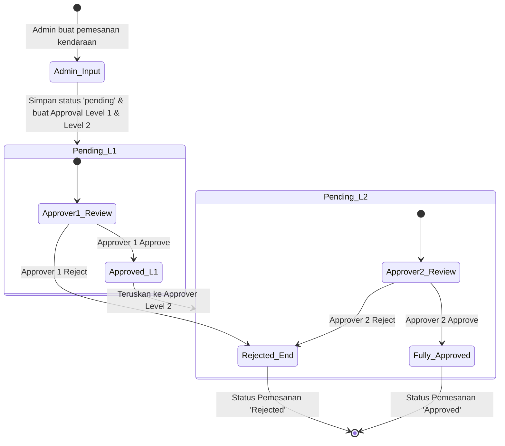

# Aplikasi Monitoring & Pemesanan Kendaraan Operasional

Aplikasi berbasis web untuk mengelola dan memonitor pemakaian armada kendaraan operasional perusahaan tambang nikel, mencakup fitur pengajuan pemesanan oleh Admin, persetujuan berjenjang (*multi-level approval*), grafik pemakaian kendaraan, laporan ekspor Excel, serta pencatatan *activity log*.

---

## 🛠️ Tech Stack & Requirements

* **Framework**: Laravel 12.x
* **PHP Version**: PHP 8.2.12
* **Database**: MariaDB / MySQL 10.4.32 (XAMPP)
* **Frontend**: Blade Template, Tailwind CSS, Chart.js
* **Package Tambahan**: `maatwebsite/excel` (Ekspor Excel)

---

## 🔑 Akun & Hak Akses (Credentials)

Sistem menyediakan 2 jenis *role* (*Admin* dan *Approver*):

| Role | Name | Email | Password | Akses Utama |
| :--- | :--- | :--- | :--- | :--- |
| **Admin** | Admin Pool | `admin@sekawan.com` | `password123` | Input pemesanan, atur driver & approver |
| **Approver (Level 1)** | Manager Operasional | `approver1@sekawan.com` | `password123` | Persetujuan tahap pertama |
| **Approver (Level 2)** | Kepala Wilayah | `approver2@sekawan.com` | `password123` | Persetujuan tahap kedua |

---

## 🚀 Panduan Instalasi & Penggunaan

### 1. Prasyarat System
* PHP >= 8.2 (Pastikan ekstensi `zip` dan `gd` aktif di `php.ini`)
* Composer
* Node.js & NPM
* Server MySQL (XAMPP/MariaDB)

### 2. Langkah Instalasi
1. Clone repositori ini atau ekstrak folder proyek:
   ```bash
   git clone <URL_REPOSITORY>
   cd vehicle-monitoring
   ```

2. Instal dependensi PHP & Node.js:
   ```bash
   composer install
   npm install
   ```

3. Konfigurasi Environment:
   * Duplikasi file `.env.example` menjadi `.env`:
     ```bash
     cp .env.example .env
     ```
   * Buat database baru bernama `db_vehicle_monitoring` di MySQL/phpMyAdmin.
   * Sesuaikan konfigurasi database pada file `.env`:
     ```env
     DB_CONNECTION=mysql
     DB_HOST=127.0.0.1
     DB_PORT=3306
     DB_DATABASE=db_vehicle_monitoring
     DB_USERNAME=root
     DB_PASSWORD=
     ```

4. Generate App Key, Migrasi Database, & Seed Data Awal:
   ```bash
   php artisan key:generate
   php artisan migrate:fresh --seed
   ```

5. Kompilasi Aset Frontend & Jalankan Server Lokal:
   * Jalankan Vite (Terminal 1):
     ```bash
     npm run dev
     ```
   * Jalankan Server Laravel (Terminal 2):
     ```bash
     php artisan serve
     ```
   * Akses aplikasi di browser melalui URL: `http://127.0.0.1:8000`

---

## 📊 Physical Data Model (PDM) & Relasi Database

```text
[roles] 1 ──── < users > 1 ──── N [activity_logs]
                  │
                  │ 1
                  │
                  └─── N [bookings] N ──── 1 [vehicles] ──── N [locations]
                            │                     │
                            │ 1                   └─── 1 [drivers]
                            │
                            └─── N [booking_approvals]
```

---

## 🔄 Activity Diagram (Fitur Pemesanan & Persetujuan Berjenjang)


